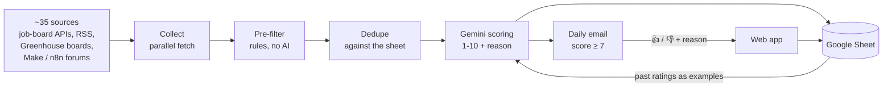

# Job Radar

[](https://github.com/sagiassraf/job-radar/actions/workflows/test.yml)

A personal job-search assistant that runs every morning. It collects remote job postings from about 35 sources, drops the ones that clearly don't fit, scores the rest with Gemini against a candidate profile, and emails the best matches. Each posting in the email has 👍 / 👎 links. The ratings go back into the model's prompt, so the radar learns the candidate's taste over time.

It runs entirely on free tiers (Google Apps Script, Google Sheets, the Gemini API free tier). The email and the sheet are in Hebrew; the code and the prompt are in English.

## Why it exists

The first version was a Make scenario. It worked, but most of what it sent was irrelevant: translation jobs that needed a language degree, very low pay, or full-time roles. It also had no way to learn from feedback, and it used about 90 Make operations a day. This version moves the logic into code, so it can filter precisely, test the filters, and close the feedback loop at no cost.

## How it works



A typical run: about 550 postings collected, about 50 pass the filters, all new ones are scored in under a minute, and 5-10 reach the email.

| File | Responsibility |
|---|---|
| [`src/Config.gs`](src/Config.gs) | Everything tunable: sources, search queries, score threshold, pay floor, time budget, model order |
| [`src/Sources.gs`](src/Sources.gs) | Fetches all sources in parallel and normalizes 7 different formats (JSON APIs, RSS, Greenhouse, Discourse forums) into one posting shape |
| [`src/Filter.gs`](src/Filter.gs) | Deterministic pre-filter: age, full-time, pay below the floor, location, translation, other languages, required degrees, seniority, off-track roles, freelancers advertising themselves on forums |
| [`src/Score.gs`](src/Score.gs) | Gemini calls with a JSON response schema, the candidate profile prompt, retries and model fallback |
| [`src/Store.gs`](src/Store.gs) | The Google Sheet as the radar's memory: scored postings, ratings, run log |
| [`src/Digest.gs`](src/Digest.gs) | The HTML email, with signed rating links |
| [`src/Web.gs`](src/Web.gs) | Web app that records 👍 / 👎 and the reason, plus token-protected test endpoints |
| [`src/Main.gs`](src/Main.gs) | Sheet menu, first-time setup, daily trigger, the pipeline itself |

## Design decisions

- **Rules first, AI second.** Most bad matches are easy to spot (the word "translator", a PhD requirement, $8/hour). A regex pre-filter removes them before the model sees anything. This cuts the model's work by about 90%, and unlike a prompt, the rules have [unit tests](tests/filter.test.cjs).
- **The candidate's own ratings are the strongest signal.** A 👎 click opens a page that asks why (low pay, too senior, wrong field, language, hours, location). Recent ratings and reasons go into the prompt as examples. "Job already closed" is also a reason, but it is never shown to the model, because it says nothing about taste.
- **Signed feedback links.** Each 👍 / 👎 link carries an HMAC signature of the posting's key, so the public web app only accepts ratings for postings it actually sent.
- **Hard caps in the prompt.** The prompt lists explicit score ceilings (for example, "requires residence that excludes Israel: at most 3"). This made the small, fast model much more consistent than asking it for a general judgment.
- **Built to survive a bad API day.** On the second day, the main Gemini model returned 503 errors and one call hung for over 5 minutes, while Apps Script stops any run at 6. Now the pipeline tries the lite model first and falls back to the next one when it is overloaded. It checks a 4-minute budget before every call. Postings that weren't scored are not marked as seen, so the next run picks them up. A failed run sends an alert email.
- **Dedupe on two keys.** The same job often appears on several boards with different URLs. Postings are matched by URL and by title + company.
- **Polite to the job boards.** Every board that asks for credit is credited in the email, and per-source request limits are respected.
- **No secrets in the repo.** The Gemini key lives in Script Properties. The tokens for the web app are kept in a git-ignored `.env` and written into a git-ignored file on each deploy.

## Development

The `.gs` files are plain JavaScript, so they also run in Node. A small harness loads them into a `vm` context with `curl`-based stand-ins for Apps Script's `UrlFetchApp`. This allows running the real collection and filters locally, without deploying.

```sh
npm test                      # filter unit tests
npm run local -- --drops      # live fetch from all sources, show what each filter dropped
npm run local -- --score      # also score with Gemini (needs GEMINI_API_KEY in the environment)
npm run deploy                # push to Apps Script with clasp and update the web app
```

### Setting up your own copy

1. Create a Google Sheet, then an Apps Script project bound to it, and point a `.clasp.json` at it with `"rootDir": "src"`.
2. Edit the candidate profile in [`src/Score.gs`](src/Score.gs) and the searches in [`src/Config.gs`](src/Config.gs).
3. Run `npm run deploy`. It creates the tokens and the web app deployment on the first run.
4. In the sheet, open the menu **רדאר משרות > הגדרה ראשונה**. It asks for a [Gemini API key](https://aistudio.google.com/apikey) and creates the daily 08:00 trigger.

## About

Built by [Sagi Assraf](https://www.linkedin.com/in/sagi-assaraf), with Claude Code as a coding assistant, as a working tool for my own job search. See also [therapy-reminders](https://github.com/sagiassraf/therapy-reminders), a WhatsApp reminder system for therapists and coaches.
